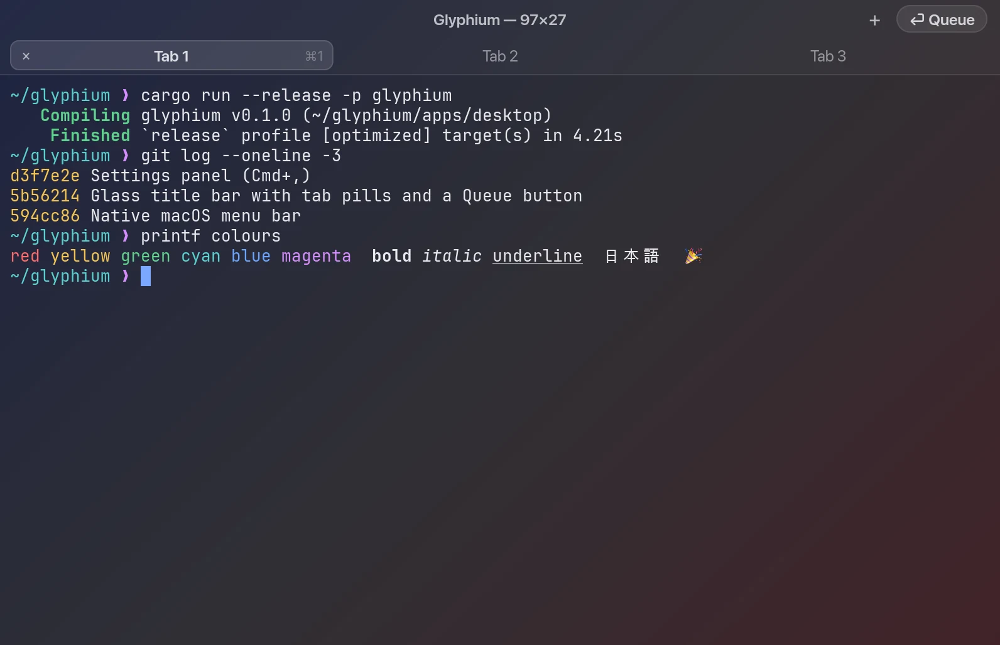
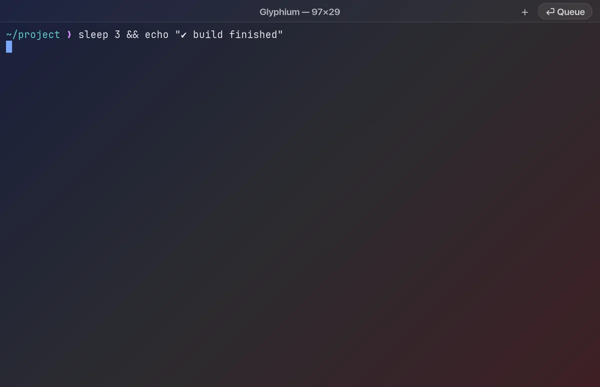
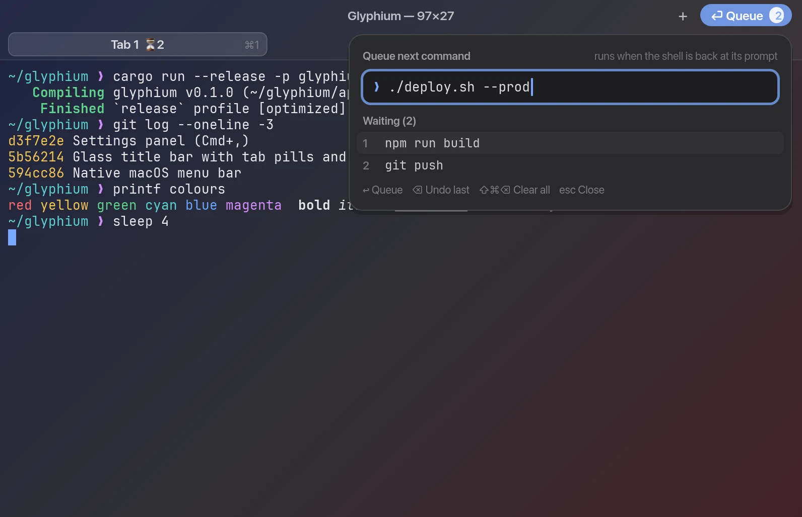
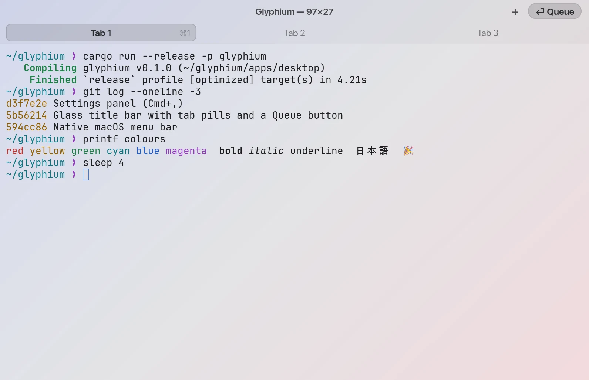
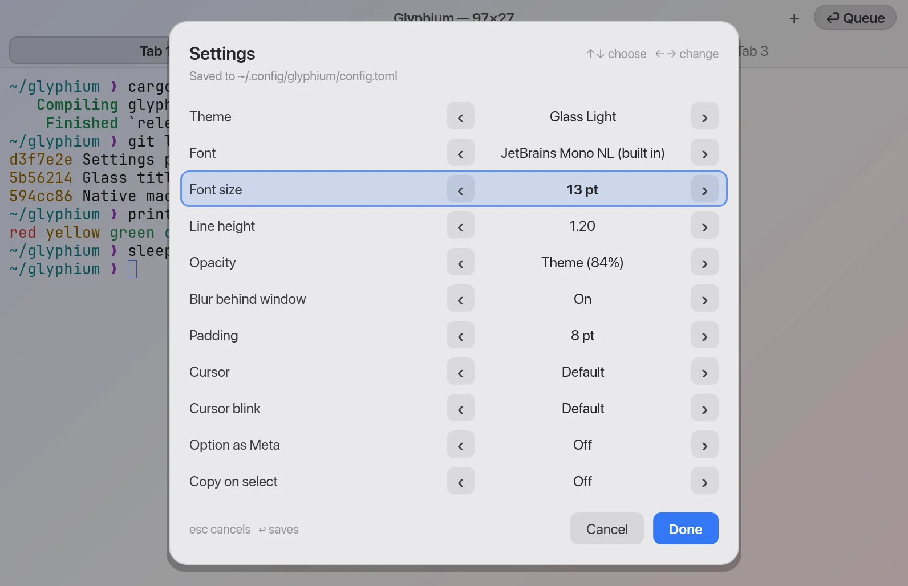

<div align="center">

# Glyphium

A GPU-rendered terminal emulator in Rust, built on libghostty-vt.

[](https://github.com/Gitguy268/glyphium/actions/workflows/ci.yml)

</div>

**Status: early development.** Milestone 1 is closed: the desktop app builds and passes real-window end-to-end scripts, and the core passes fuzz tests. See [docs/PROGRESS.md](docs/PROGRESS.md) and [docs/adr/0001-core.md](docs/adr/0001-core.md).

<p align="center"></p>

<p align="center"><sub>Screenshots are the app's own captures laid over a sample wallpaper, since a translucent window shows whatever is behind it.</sub></p>

<!-- live-links -->
**Project page:** [gitguy268.github.io/glyphium](https://gitguy268.github.io/glyphium/) · [glyphium-red.vercel.app](https://glyphium-red.vercel.app)
<!-- /live-links -->

## Install with Homebrew

```sh
brew trust gitguy268/tap
brew install gitguy268/tap/glyphium
```

This builds Ghostty's terminal core and glyphium from source on macOS (a few minutes; Rust and Zig are fetched as build tools). Then run `glyphium`.

<!-- run-steps:start -->
## Run it locally, step by step

1. **Install [Rust](https://rustup.rs)** and [Zig](https://ziglang.org/download/), which builds the terminal core.

2. **Get the code:**

   ```sh
   git clone https://github.com/Gitguy268/glyphium.git
   cd glyphium
   ```

3. **Build the terminal core from Ghostty:**

   ```sh
   git clone https://github.com/ghostty-org/ghostty.git .tools/ghostty
   git -C .tools/ghostty checkout cec8b92
   (cd .tools/ghostty && zig build -Demit-lib-vt -Doptimize=ReleaseFast)
   ```

4. **Build and start the desktop app:**

   ```sh
   cargo run --release -p glyphium
   ```

5. **Quit** by closing the window. The first build takes several minutes.
<!-- run-steps:end -->

## Using it

### Queue the next command

<p align="center"></p>

Click **⏎ Queue** in the title bar, choose **Shell › Queue Next Command…**, or press **Cmd+Shift+Enter**. Type a command and press **Enter**. If the shell is at its prompt, the command runs at once. Otherwise it waits until the current command finishes. You can queue several, and they run one at a time in order. The Queue button shows how many are waiting, the popover lists them, and a tab with queued commands shows `⏳n` in its label.

| In the queue popover | Does |
| --- | --- |
| Enter | Adds the command |
| Esc, or a click outside | Closes the popover |
| Backspace on an empty line | Removes the last queued command |
| Cmd+V | Pastes, with newlines turned into spaces |
| Cmd+Shift+Backspace | Clears the pane's queue (also works outside the popover) |

<details>
<summary>How Glyphium knows a command has finished</summary>

Glyphium checks which process owns the terminal. While the shell is at its prompt, it owns the terminal; while a command runs, that command does. No shell setup is needed. After typing a queued command, Glyphium waits until it has seen that command run and the shell take the terminal back before typing the next one. A program that reads input, such as `head`, `ssh` or a password prompt, therefore never receives the next queued command as its input. Builtins such as `cd` never leave the shell, so for those Glyphium waits until the output has been quiet for 150 ms.

Limits:
- The queue needs a shell. It is turned off when the window runs another program with `-e`.
- A builtin that waits for input, such as `read`, looks finished.
- It does not yet work on Windows.

</details>

<p align="center"></p>

### Themes

Pick a theme from **View › Theme**, in **Settings** (Cmd+,), or cycle with **Cmd+Shift+T**. The default, `auto`, follows the system appearance: Glass Light in light mode, Glass Dark in dark mode.

| Built-in theme | Name in the config |
| --- | --- |
| Glass Dark, Glass Light (translucent) | `glass-dark`, `glass-light` |
| Nujabes, Ye: Graduation | `nujabes`, `graduation` |
| Solarized Dark, Solarized Light | `solarized-dark`, `solarized-light` |
| Dracula | `dracula` |
| Catppuccin Mocha, Catppuccin Latte | `catppuccin-mocha`, `catppuccin-latte` |
| Tokyo Night | `tokyo-night` |
| Ghostty's own colours | `default` |

**Your own themes:** put a file in `~/.config/glyphium/themes/`. Its file name is the theme's name, and it appears in the Theme menu and in Settings. The format is Ghostty's, so the hundreds of theme files from Ghostty and [iTerm2-Color-Schemes](https://github.com/mbadolato/iTerm2-Color-Schemes) (its `ghostty/` folder) work as they are. Missing keys come from Glass Dark.

```text
# ~/.config/glyphium/themes/night-owl
background = #011627
foreground = #d6deeb
cursor-color = #80a4c2
selection-background = #1d3b53
palette = 4=#82aaff
background-opacity = 0.9
```

**One colour on top of any theme:** add the same keys to `config.toml`, for example `background = #101014` or `palette = 1=#ff5f5f`.

<p align="center"></p>

### Settings

<p align="center"></p>

**Cmd+,** opens the Settings panel. Up and Down choose a row, Left and Right change it, and every change shows at once. **Done** (Enter) saves only what you changed to `~/.config/glyphium/config.toml`, keeping your comments; **Cancel** (Esc) puts everything back.

You can also edit the file in any editor: **Glyphium › Open Config File** creates it with every setting listed and commented out. Save it and switch back to the window, and the changes apply without a restart. A line Glyphium can't read shows a warning and keeps the default for that setting.

<details>
<summary>Every setting</summary>

| Key | Default | Values |
| --- | --- | --- |
| `font_family` | JetBrains Mono NL (bundled) | Any installed monospaced font. `SF Mono` is read from macOS's Terminal.app at run time if it isn't installed |
| `font_size` | `13` | Points, 4–96 |
| `line_height` | `1.2` | Times the font size, 0.8–3 |
| `theme` | `auto` | `auto`, `default`, a theme name, or a path to a theme file |
| `theme_light`, `theme_dark` | `glass-light`, `glass-dark` | What `auto` uses |
| `background`, `foreground`, `cursor_color`, `selection_background`, `palette = N=#hex` | from the theme | Colour overrides |
| `opacity` | from the theme (Glass: 0.80 / 0.84, others 1) | 0.3–1, macOS |
| `blur` | `true` | Blur what is behind a translucent window, macOS |
| `padding` | `8` | Points around the text in each pane |
| `window_columns`, `window_rows` | `100`, `30` | Size of a new window |
| `cursor_style` | `default` | `block`, `bar`, `underline` |
| `cursor_blink` | `default` | `true`, `false` |
| `option_as_meta` | `false` | macOS: Option sends Esc+key instead of special characters |
| `copy_on_select` | `false` | Copy a selection when the mouse is released |
| `confirm_paste` | `true` | Ask before a multi-line paste that may run commands |
| `scrollback` | `10000` | Lines per pane |

Glyphium reads `--config FILE` first, then `$GLYPHIUM_CONFIG`, then `config.toml` in `$GLYPHIUM_CONFIG_DIR` or `~/.config/glyphium`. A program can still change the cursor shape; `cursor_style` is the shape a new pane starts with, and a program that resets the cursor gets Ghostty's default block.

</details>

### Window and menus

The title bar is drawn in the terminal's own colours behind the traffic lights, like the Terminal app's. With more than one tab, the tabs show as pills on a second row: click one to switch, hover for its close button, or use **+** for a new tab. Drag empty title bar space to move the window, and double-click it to zoom. The macOS menu bar has every action, with its shortcut, under Glyphium, Shell, Edit, View and Window.

<details>
<summary>All shortcuts</summary>

On Linux and Windows, use Ctrl+Shift where macOS uses Cmd (the theme shortcut is Ctrl+Shift+Alt+T).

| Shortcut | Does |
| --- | --- |
| Cmd+T | New tab |
| Cmd+W | Close pane |
| Cmd+D / Cmd+Shift+D | Split right / split down |
| Cmd+Alt+Arrow | Move focus between splits |
| Cmd+[ / Cmd+] | Previous / next tab |
| Cmd+1…9 | Go to tab |
| Cmd+C / Cmd+V | Copy selection / paste |
| Cmd+= / Cmd+- / Cmd+0 | Bigger / smaller / reset font |
| Shift+PageUp / Shift+PageDown | Scroll back |
| Cmd+Shift+Enter | Queue the next command |
| Cmd+Shift+Backspace | Clear the queue |
| Cmd+Shift+T | Next theme |
| Cmd+, | Settings |
| Cmd+click | Open a link |
| Cmd+Q | Quit |

</details>

## Tests

```sh
cargo test --release -p glyphium-terminal-core -p glyphium-terminal-render -p glyphium-session-host -p glyphium
cargo build --release -p glyphium && tests/e2e/run.sh OUT_DIR   # opens a real window per script
```

Each e2e script gets its own empty settings folder, so your own `~/.config/glyphium` is never read or written.

CI runs the first line and clippy on macOS for every push and pull request.

## Licence

See [LICENSE](LICENSE).
